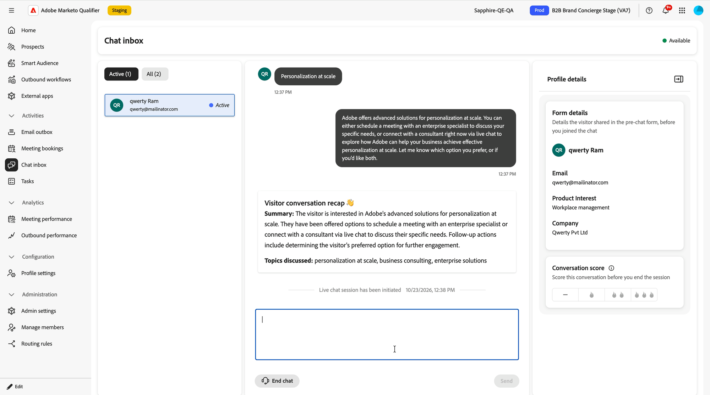

# Bandeja de entrada de chat {#chat-inbox}

Cuando un visitante pide hablar con alguien, el chat llega a la **[!UICONTROL bandeja de entrada del chat]** en [!DNL Adobe Marketo Qualifier]. Esta página es la vista del representante de un chat en vivo: lo que ves cuando llega, qué contexto obtienes y qué tienes que hacer antes de poder cerrarlo.

Para abrir la bandeja de entrada del chat, en el panel izquierdo bajo **[!UICONTROL Actividades]**, seleccione **[!UICONTROL Bandeja de entrada del chat]**.

## Recibir un chat {#receive}

Su estado aparecerá en la esquina superior derecha de la bandeja de entrada. **[!UICONTROL Disponible]** significa que puedes recibir chats ahora. Tu horario de disponibilidad de chat en vivo decide si cumples los requisitos; consulta [Establecer disponibilidad de chat en vivo](representative-setup.md#chat-availability).

El modo en que un chat llegue a usted depende del tipo de enrutamiento establecido en la integración de **[!UICONTROL Live Chat]**:

* Con round robin, todos los representantes elegibles reciben una notificación al mismo tiempo y el primero en aceptar toma la conversación.
* Con el agente directo, el chat siempre llega al representante designado.
* Con el enrutamiento personalizado, el chat va a los representantes asignados a la regla de mayor prioridad con la que coincidió el visitante.

Dos pestañas organizan las conversaciones:

* **[!UICONTROL Activo]** — conversaciones en curso.
* **[!UICONTROL Todas]**: todas las conversaciones, incluidas las que han finalizado.

## Recoge la conversación {#pick-up}

Nunca empiezas a hacer frío. Antes de escribir nada, la bandeja de entrada le proporciona todo lo que el visitante ya le ha dicho al conserje.

{width="800" zoomable="yes"}

| Lo que ve | Lo que te da |
| --- | --- |
| **[!UICONTROL Resumen de conversación de visitante]** | Un **[!UICONTROL resumen]** de la conversación que el visitante tuvo con el conserje y los **[!UICONTROL temas tratados]** |
| Transcripción de conversación | El intercambio completo con el conserje, por encima del punto donde se inició el chat en vivo |
| **[!UICONTROL Detalles del formulario]** | Lo que el visitante introdujo en el formulario de prechat antes de que usted se uniera, como correo electrónico, interés del producto y compañía |

La transcripción marca el traspaso con dos líneas de sistema, `Live chat session has been initiated` y `Agent <name> has joined the chat`, para que siempre pueda saber qué parte de la conversación fue el conserje y qué parte es la suya.

Escriba en el cuadro de mensaje y seleccione **[!UICONTROL Enviar]** para responder.

{width="800" zoomable="yes"}

## Puntuación de la conversación {#conversation-score}

Antes de finalizar un chat, evalúe la calificación del visitante. La puntuación la establece usted, el representante que realmente habló con el visitante, que es lo que lo hace confiable en la fase posterior.

En el panel **[!UICONTROL Detalles del perfil]**, en **[!UICONTROL Puntuación de la conversación]**, seleccione una clasificación. El guión significa que no hay puntuación, y los iconos de llamas califican la conversación de menos a más calificada.

{width="600" zoomable="yes"}

| Selección | Valor almacenado | Significado |
| --- | --- | --- |
| Guión | 0 | Menos cualificado |
| Una llama | 1 | Algo cualificado |
| Dos llamas | 2 | Cualificado |
| Tres llamas | 3 | El más cualificado |

>[!IMPORTANT]
>
>La puntuación es obligatoria. Si intenta cerrar una conversación sin puntuarla, aparecerá el error `Please score the conversation before you close the chat` y la conversación permanecerá abierta. Después de puntuarlo, aparece una confirmación y puede cerrar el chat.

{width="800" zoomable="yes"}

La puntuación se escribe en la actividad **[!UICONTROL Participar con chat en vivo en Concierge]** en [!DNL Marketo Engage], donde está disponible como restricción en filtros y déclencheur. Utilícelo para dirigir el redireccionamiento, la puntuación de posibles clientes, la personalización y el traspaso a CRM. Ver [datos de Brand Concierge en Marketo Engage](marketo-activities.md).

## Finalizar el chat {#end-chat}

Seleccione **[!UICONTROL Finalizar conversación]** para cerrar la conversación. El visitante también puede enviarlo por su parte y se le pide que confirme primero.

Cuando se cierra un chat, su estado de conversación se registra como uno de los dos valores siguientes:

* **Finalizado** — la conversación fue cerrada deliberadamente, por usted o por el visitante.
* **Se perdió**: el visitante abandonó el sitio y la conversación agotó el tiempo de espera debido a la inactividad.

>[!NOTE]
>
>Las conversaciones de chat en vivo se conservan durante 30 días.

## Siguiente paso {#next}

Vea lo que todo esto escribe en su base de datos de marketing en [datos de Brand Concierge en Marketo Engage](marketo-activities.md).
