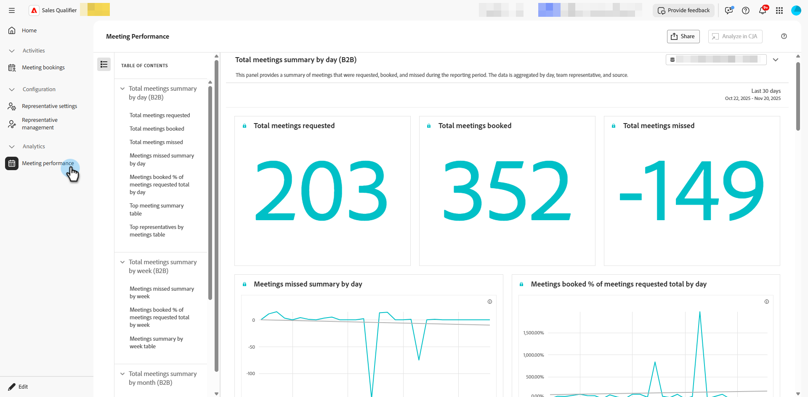

# Monitorización de reuniones y charlas en directo {#monitor}

[!DNL Adobe Marketo Qualifier] guarda el registro operativo de cada transferencia: las reuniones que se reservaron, las charlas que se realizaron y el desempeño del equipo frente a ellas.

## Revisar reuniones reservadas {#bookings}

En **[!UICONTROL Actividades]**, seleccione **[!UICONTROL Reservas de reuniones]** para revisar las reuniones que se han reservado, ver la información capturada para cada una y saber cuándo se programó cada reunión.

{width="800" zoomable="yes"}

## Revisar chats en directo {#chats}

En **[!UICONTROL Actividades]**, seleccione **[!UICONTROL Bandeja de entrada de chat]** y, a continuación, abra la ficha **[!UICONTROL Todo]** para ver todas las conversaciones, incluidas las que hayan finalizado. Ver [Bandeja de entrada de chat](chat-inbox.md).

>[!NOTE]
>
>Las conversaciones de chat en vivo se conservan durante 30 días.

## Analizar el rendimiento de reuniones {#performance}

En **[!UICONTROL Analytics]**, seleccione **[!UICONTROL Rendimiento de la reunión]** para revisar varias categorías de análisis, incluyendo cuántos visitantes solicitaron reuniones y cuántas se perdieron. También se puede ver la tendencia de las reuniones a lo largo del tiempo y qué representantes las tomaron.

{width="800" zoomable="yes"}

## Analizar la participación del conserje en Marketo Engage {#marketo}

Para una segmentación más profunda, que incluya puntuación de conversación, tipo de enrutamiento y reservas de reuniones abandonadas, use los tipos de actividades de conserjería en [!DNL Marketo Engage]. Ver [datos de Brand Concierge en Marketo Engage](marketo-activities.md).
