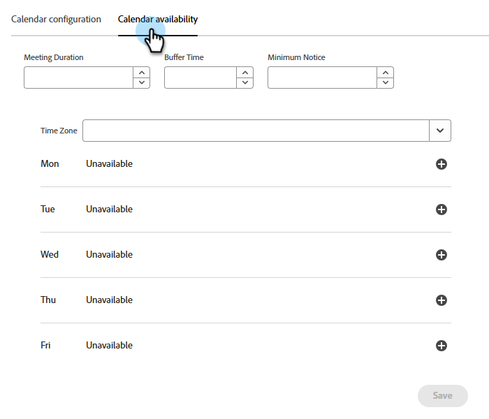

# Configuración de representantes en Adobe Marketo Qualifier {#representative-setup}

Antes de que un conserje pueda ofrecer una reunión o una conversación en vivo, debe haber al menos un representante configurado en [!DNL Adobe Marketo Qualifier]. Cada representante hace esto una vez, en su propio perfil.

La secuencia es la siguiente: un administrador añade los usuarios y cada representante conecta un calendario, escribe su correo electrónico de confirmación y declara cuándo están disponibles para reuniones y charlas.

## Añadir usuarios a la organización {#add-users}

Un administrador agrega a cada representante de ventas como un usuario en [!DNL Adobe Admin Console] y le concede acceso a [!DNL Adobe Marketo Qualifier]. Para ver el procedimiento general, consulte [Agregar un usuario a la organización](../user-and-access-management/add-a-user-to-the-org.md) y [Agregar un usuario al rol](../user-and-access-management/add-a-user-to-the-role.md).

Los representantes completan ellos mismos los pasos restantes.

## Conectar el calendario {#connect}

La conexión del calendario es lo que hace que la disponibilidad real sea visible para un conserje. Sin él, el representante no es apto para la reserva de reuniones.

1. Inicie sesión en [Adobe Experience Cloud](https://experience.adobe.com/){target="_blank"} y seleccione **[!UICONTROL Adobe Marketo Qualifier]**.

   {width="800" zoomable="yes"}

1. En el panel izquierdo, en **[!UICONTROL Configuración]**, seleccione **[!UICONTROL Configuración del perfil]** y, a continuación, abra la pestaña **[!UICONTROL Configuración del calendario]**.

1. Elija el calendario al que desea conectarse: [!DNL Microsoft Outlook] o [!DNL Google Calendar].

   {width="600" zoomable="yes"}

1. Inicie sesión con una cuenta existente o agregue una nueva y conceda los permisos solicitados.

   {width="600" zoomable="yes"}

1. Revise el correo electrónico de confirmación que se envía a un visitante cuando reserva una reunión con usted.

   Se establecen una línea de asunto y un cuerpo predeterminados para usted. Edite cualquiera de ellos y elija si desea incluir un vínculo de reunión [!DNL Microsoft Teams] en la invitación.

   {width="600" zoomable="yes"}

1. Seleccione **[!UICONTROL Guardar]**.

## Establecer disponibilidad del calendario {#calendar-availability}

Al conectar un calendario, se indica a [!DNL Adobe Marketo Qualifier] cuándo está *ocupado*. La disponibilidad del calendario le indica cuándo está *dispuesto* a asistir a una reunión. Se aplican ambos.

1. En **[!UICONTROL Configuración del perfil]**, abra la pestaña **[!UICONTROL Disponibilidad del calendario]**.

   {width="600" zoomable="yes"}

1. Establezca las reglas de la reunión.

   | Configuración | Qué controla |
   | --- | --- |
   | Duración de reunión | El tiempo que se ejecuta una reunión reservada y, por lo tanto, la duración de cada espacio ofrecido |
   | Tiempo de búfer | La diferencia entre el final de una reunión y el comienzo de la siguiente |
   | Aviso mínimo | La anticipación que debe realizar un visitante. Por ejemplo, establezca 4 horas para evitar que los visitantes reserven un espacio que comience en 10 minutos |
   | Zona horaria | El huso horario en el que se expresan las horas de disponibilidad. Los visitantes siempre ven las ranuras convertidas a su propia zona horaria |

1. Establezca las horas disponibles para cada día de la semana.

   Un día puede ser un bloque continuo, como 8:00 a.m. a 5:00 p.m., o varios bloques, como 8:00 a.m. a 12:00 p.m. y 2:00 p.m. a 5:00 p.m. Deje un día vacío para no celebrar ninguna reunión ese día.

   >[!NOTE]
   >
   >Para agregar otro bloque de tiempo a un día, seleccione el signo más ().

   {width="600" zoomable="yes"}

1. Seleccione **[!UICONTROL Guardar]**.

### Cómo se puede reservar una ranura {#slot-logic}

Un intervalo de tiempo se ofrece a un visitante solo cuando sobrevive a las tres comprobaciones:

1. Se encuentra dentro de las horas disponibles establecidas aquí.
1. No está ya ocupado por un evento del calendario conectado. Una reunión existente a las 9:00 a.m. elimina el espacio de las 9:00 a.m.
1. Cumple con su tiempo mínimo de notificación y amortiguación.

## Establecer disponibilidad de chat en vivo {#chat-availability}

La disponibilidad del chat en vivo es independiente de la disponibilidad del calendario. Un representante puede estar disponible para charlar, pero no tiene reuniones, o al revés.

1. En la **[!UICONTROL configuración del perfil]**, abre la pestaña **[!UICONTROL Disponibilidad del chat en vivo]**.

1. Establece tu huso horario, luego establece los días y las horas cuando estés dispuesto a recibir un chat en vivo. Los fines de semana se pueden incluir.

   {width="600" zoomable="yes"}

1. Seleccione **[!UICONTROL Guardar]**.

>[!NOTE]
>
>Las horas de disponibilidad te hacen *elegible* para charlas. Su estado en vivo en la bandeja de entrada de chat decide si usted los recibe en este momento. Ver [Bandeja de entrada de chat](chat-inbox.md).

## Revisar quién está configurado {#manage-members}

**Solo administradores.** En **[!UICONTROL Administración]**, seleccione **[!UICONTROL Administrar miembros]** para ver el estado de cada representante en un solo lugar: que haya conectado un calendario, que haya establecido la disponibilidad del chat en vivo y que haya desconectado un calendario.

Utilícelo antes de activar las integraciones en Composer. Un representante que aparece aquí sin un calendario conectado no es elegible para la reserva de reunión, y uno sin disponibilidad de chat en vivo no es elegible para chat en vivo.

{width="800" zoomable="yes"}

## Siguiente paso {#next}

Con al menos un representante configurado, decida cómo se relacionan los visitantes con los representantes. Ver [Enrutar conversaciones a los representantes](routing-rules.md).
