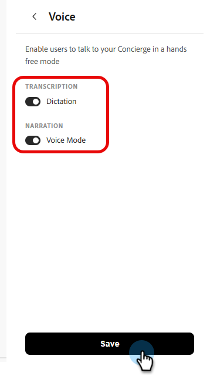

# Activar conversaciones de voz

Las conversaciones de voz en Adobe Brand Concierge permiten que los visitantes hablen con un conserje en lugar de escribir. La voz admite interacciones manos libres y mantiene la experiencia multimodal, por lo que el conserje puede seguir proporcionando texto, imágenes y enlaces.

## Cómo activar la voz

1. En la pantalla de **Inicio**, en **Sus conserjes**, seleccione el conserje que desee editar.

   {width="800" zoomable="yes"}

1. En la ficha **Diseño**, seleccione **Voz**.

   {width="800" zoomable="yes"}

   >[!NOTE]
   >
   >La primera vez que habilites Voice, debes revisar el aviso de privacidad antes de continuar.

1. En el panel _Voz_, habilite las opciones que desee y, a continuación, seleccione **Guardar**.
   - **Dictado**: transcribe en texto lo que dicen los visitantes.
   - **Modo de voz**: Lee en voz alta las respuestas del conserje.

   

   >[!NOTE]
   >
   >Los controles disponibles pueden variar según la configuración de su conserje.

## La experiencia del visitante

### Los visitantes pueden hablar de forma natural

Después de activar la voz, los visitantes pueden hablar de forma natural con el conserje. La detección automática de voz comienza y deja de escuchar, por lo que los visitantes no tienen que seleccionar un botón para cada turno.

Los visitantes también pueden interrumpir al conserje mientras habla, por lo que no tienen que esperar a que la respuesta termine.

### Respuestas de texto y visuales

La voz no limita al conserje al audio. Durante una conversación de voz, el conserje puede devolver texto, imágenes y enlaces como parte de su respuesta.

## Cómo desactivar la voz

1. En la pantalla de **Inicio**, en **Sus conserjes**, seleccione el conserje que desee editar.

1. En la ficha **Diseño**, seleccione **Voz**.

1. En el panel _Voz_, deshabilita las opciones que deseas desactivar y, a continuación, selecciona **Guardar**.
